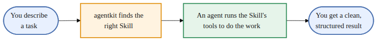
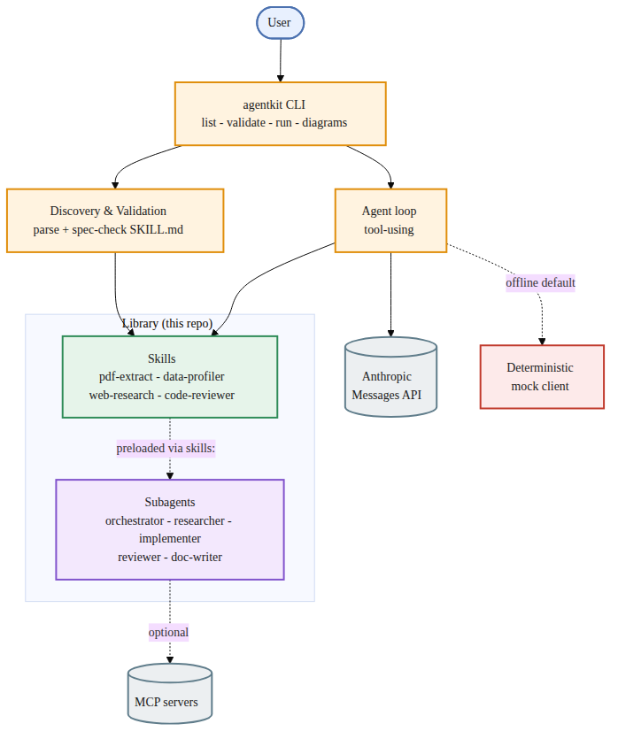
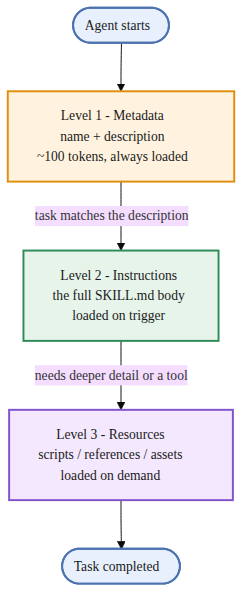
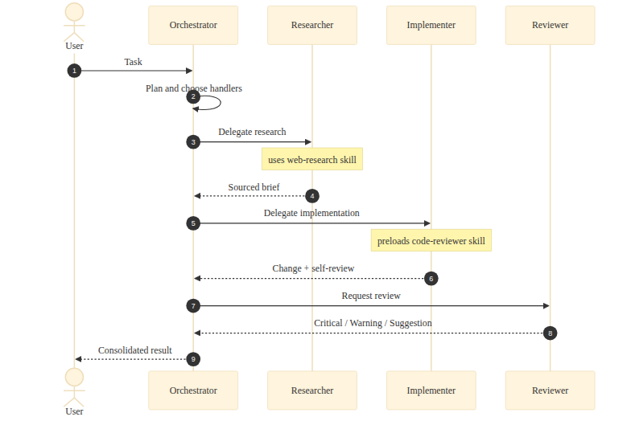

# agentkit

A command-line tool and small library for working with AI Agent Skills and subagents: discover them, validate them against the open `SKILL.md` specification, and run a skill through a tool-using agent loop. It runs offline by default, so no API key is needed to try it.

[](https://github.com/jjsanda/agentkit/actions/workflows/ci.yml) [](LICENSE) [](https://www.python.org/)



## Overview

Skills are reusable folders of instructions and scripts in the open [`SKILL.md`](https://agentskills.io) format. Subagents are focused helpers defined by Markdown files with YAML frontmatter. agentkit ties the two together: it finds skills on disk, checks them against the specification, and runs a demo loop where an agent loads a skill and calls its scripts as tools. With no API key set the loop uses a deterministic mock client; set `ANTHROPIC_API_KEY` to run against the real model.

## Architecture



- CLI and runtime (`src/agentkit/`): discovery, validation, the agent loop, and a diagram exporter, all behind one `agentkit` command.
- Skills library (`skills/`): four skills in the `SKILL.md` format, each with a tested, side-effect-free script or reference file.
- Subagents (`agents/`): five role-focused agents. Two of them preload a skill through the `skills:` frontmatter field, which links a skill to a subagent.
- LLM backend: the loop calls the Anthropic Messages API in real mode, or a deterministic mock client when offline.

## Quickstart

```bash
git clone https://github.com/jjsanda/agentkit.git
cd agentkit
make install
source .venv/bin/activate
agentkit validate
agentkit run "Summarize the sample PDF" --skill pdf-extract --mock
```

`agentkit run` falls back to mock mode when no API key is present. Set `ANTHROPIC_API_KEY` (see `.env.example`) to use the real model.

## Skills

| Skill | What it does | When to use |
|---|---|---|
| [`pdf-extract`](skills/pdf-extract/) | Extract text and tables from a PDF to Markdown or CSV | Working with PDFs, statements, reports |
| [`data-profiler`](skills/data-profiler/) | Profile a CSV into a Markdown quality report and a chart | Sizing up a dataset before analysis |
| [`web-research`](skills/web-research/) | A method for producing a sourced research brief | Researching or fact-checking a topic |
| [`code-reviewer`](skills/code-reviewer/) | A review checklist and Critical/Warning/Suggestion format | Reviewing a diff or self-checking |

`agentkit validate` checks every skill against the [agentskills.io](https://agentskills.io/specification) naming and description rules and exits non-zero on any violation.

## Subagents

| Agent | Role | Tools | Preloads skill |
|---|---|---|---|
| [`orchestrator`](agents/orchestrator.md) | Plans a task and delegates | `Read, Grep, Glob` | none |
| [`researcher`](agents/researcher.md) | Read-only research; returns a sourced brief | `Read, Grep, Glob, WebSearch, WebFetch` | `web-research` |
| [`implementer`](agents/implementer.md) | Writes code and self-reviews | `Read, Write, Edit, Bash, Glob, Grep` | `code-reviewer` |
| [`reviewer`](agents/reviewer.md) | Read-only review, no writes | `Read, Grep, Glob` | none |
| [`doc-writer`](agents/doc-writer.md) | Writes and maintains docs | `Read, Write, Edit, Glob, Grep, WebFetch` | none |

`make claude-install` symlinks `skills/` and `agents/` into `.claude/` so Claude Code can discover them.

## How it works

Skills load progressively: only a skill's name and description stay in context until a task matches, then the body loads, and bundled scripts run on demand.



When several agents work together, an orchestrator plans the work, delegates to focused subagents (which can preload skills), and consolidates the result.



## Engineering practices

- Typed with mypy in strict mode; ships a `py.typed` marker.
- Linted and formatted with Ruff.
- Tested with pytest; CI enforces an 80% line-and-branch coverage gate.
- GitHub Actions runs lint, types, and tests on Python 3.11 and 3.12, and renders every Mermaid diagram so a broken diagram fails the build.
- Packaged with hatchling and a console-script entry point; the heavier skill dependencies sit behind an optional `skills` extra.
- Pre-commit runs Ruff, mypy, file-hygiene hooks, and `agentkit validate`.
- No secrets in the repo: keys come from the environment, and skill scripts make no network calls unless a key is explicitly provided.

Run the whole gate locally with `make all`.

## Project layout

```text
agentkit/
├── src/agentkit/      # runtime: discovery, validation, agent_loop, diagrams, cli
├── skills/            # Agent Skills in the SKILL.md format, with tests
├── agents/            # subagent definitions (Markdown + YAML frontmatter)
├── tests/             # runtime test suite
├── docs/diagrams/     # Mermaid sources and exported SVG/PNG
├── examples/          # sample inputs and a demo walkthrough
├── pyproject.toml
├── Makefile
└── .github/workflows/ci.yml
```

## Roadmap

- Publish the skills as an installable bundle.
- A TypeScript MCP server that exposes the same skills as MCP tools.
- Stream agent-loop output and report token usage in real mode.
- An `agentkit new-skill <name>` scaffolder that emits a spec-valid template.

## References

- Agent Skills specification: <https://agentskills.io/specification>
- Anthropic Agent Skills overview: <https://platform.claude.com/docs/en/agents-and-tools/agent-skills/overview>
- "Equipping agents for the real world with Agent Skills" (Anthropic): <https://www.anthropic.com/engineering/equipping-agents-for-the-real-world-with-agent-skills>
- Anthropic reference skills: <https://github.com/anthropics/skills>
- Claude Code subagents: <https://code.claude.com/docs/en/sub-agents>
- Claude Code skills: <https://code.claude.com/docs/en/skills>
- Mermaid CLI: <https://github.com/mermaid-js/mermaid-cli>

The "no XML tags" rule for `name`/`description` and the reserved-word check (`anthropic`, `claude`) come from the Anthropic docs and are not listed on agentskills.io; `agentkit validate` enforces both.

## License

Apache-2.0. Copyright 2026 Josef Sanda. See [LICENSE](LICENSE).
